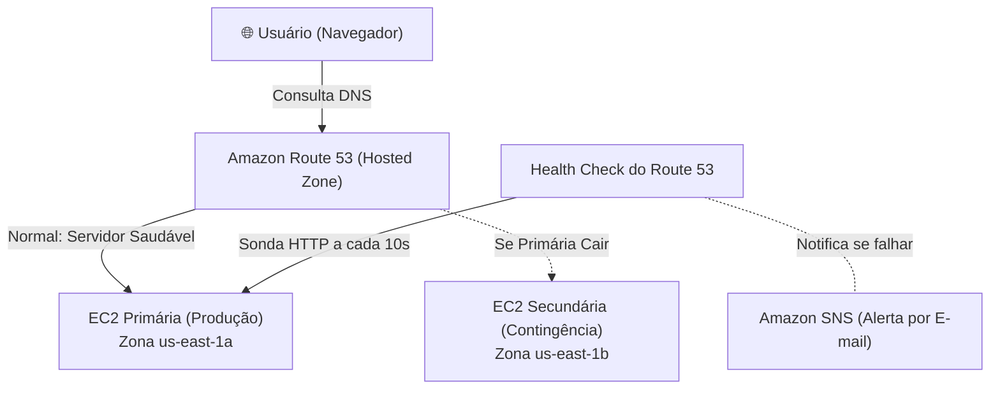

# Lab AWS - Alta Disponibilidade e Roteamento de Failover com Amazon Route 53

Prática realizada durante a formação **AWS re/Start (Escola da Nuvem)** com foco em alta disponibilidade, continuidade de negócios e contingência entre servidores.

Toda a configuração foi feita diretamente pelo **Console da AWS**, utilizando duas instâncias EC2 e a política de roteamento de Failover do Amazon Route 53.

---

## 🏛️ Cenário e Arquitetura

O objetivo é manter a aplicação disponível mesmo se o servidor principal cair. O Amazon Route 53 monitora a saúde do servidor principal e, se detectar indisponibilidade, altera automaticamente o apontamento de DNS para o servidor de contingência (secundário).



---

## 🛠️ Passo a Passo no Console da AWS

### 1. Criar as duas instâncias EC2 (Console EC2)
- Criar a **EC2 Primária** em `us-east-1a` e a **EC2 Secundária** em `us-east-1b` com Amazon Linux 2023.
- Security Group com porta 80 (HTTP) liberada para a internet.
- Conectar via SSH ou Console EC2 Instance Connect em cada uma e instalar o servidor web Apache com páginas diferenciadas:

**No Servidor Primário:**
```bash
sudo dnf install -y httpd
sudo systemctl start httpd
sudo systemctl enable httpd
echo "<h1 style='color:green;'>Servidor Primário - Produção Online</h1>" | sudo tee /var/www/html/index.html
```

**No Servidor Secundário:**
```bash
sudo dnf install -y httpd
sudo systemctl start httpd
sudo systemctl enable httpd
echo "<h1 style='color:orange;'>Servidor Secundário - Backup / Failover Ativo</h1>" | sudo tee /var/www/html/index.html
```

### 2. Configurar o Alerta no Amazon SNS (Console SNS)
- Criar um Tópico Standard chamado `alerta-queda-site`.
- Criar uma Inscrição (Subscription) com o protocolo **Email** inserindo o seu e-mail para receber as notificações de queda.
- Confirmar a inscrição no e-mail recebido.

### 3. Criar o Health Check (Console Route 53)
- Ir em **Route 53** > **Health Checks** > **Create health check**.
- Nome: `healthcheck-servidor-primario`
- O que monitorar: **Endpoint**
- Protocolo: HTTP, Porta 80, Caminho: `/`
- Endereço IP: Colar o **IP público da EC2 Primária**.
- Intervalo de solicitação: **Fast (10 segundos)** para detecção rápida.
- Limite de falhas: **3** (detecta queda em ~30 segundos).
- Em Alarmes do CloudWatch: associar ao tópico do Amazon SNS criado para disparar e-mail se o status mudar para *Unhealthy*.

### 4. Configurar os Registros de DNS de Failover (Console Route 53)
Na sua Hosted Zone no Route 53, foram criados 2 registros com o mesmo nome:

1. **Registro Primário:**
   - Tipo de registro: **A**
   - Política de roteamento: **Failover**
   - Tipo de registro de failover: **Primary**
   - Valor: IP público da **EC2 Primária**
   - TTL: **60 segundos** (baixo para propagar rápido a mudança)
   - Associar com o Health Check: selecionar `healthcheck-servidor-primario`.

2. **Registro Secundário:**
   - Tipo de registro: **A**
   - Política de roteamento: **Failover**
   - Tipo de registro de failover: **Secondary**
   - Valor: IP público da **EC2 Secundária**
   - TTL: **60 segundos**
   - Associar com o Health Check: Não.

---

## 🧪 Testando o Failover na Prática

1. Acesse o domínio no navegador: a página verde do **Servidor Primário** será exibida.
2. **Simular a queda:** Acesse a EC2 Primária pelo terminal e pare o Apache:
   ```bash
   sudo systemctl stop httpd
   ```
3. Aguarde cerca de 30 a 40 segundos:
   - O Health Check do Route 53 mudará para o status **Unhealthy** no console.
   - Você receberá um e-mail do Amazon SNS alertando a falha.
   - Atualize a página no navegador: automaticamente aparecerá a página laranja do **Servidor Secundário**.
4. **Restaurar o serviço:** Inicie novamente o Apache na primária:
   ```bash
   sudo systemctl start httpd
   ```
   - O Health Check volta para **Healthy** e o Route 53 retorna o tráfego para a primária.

---

## 🧹 Limpeza de Recursos (Teardown)
1. Excluir os registros de Failover e o Health Check no Route 53.
2. Excluir o tópico no Amazon SNS.
3. Finalizar (Terminate) as duas instâncias EC2 para evitar cobranças.
