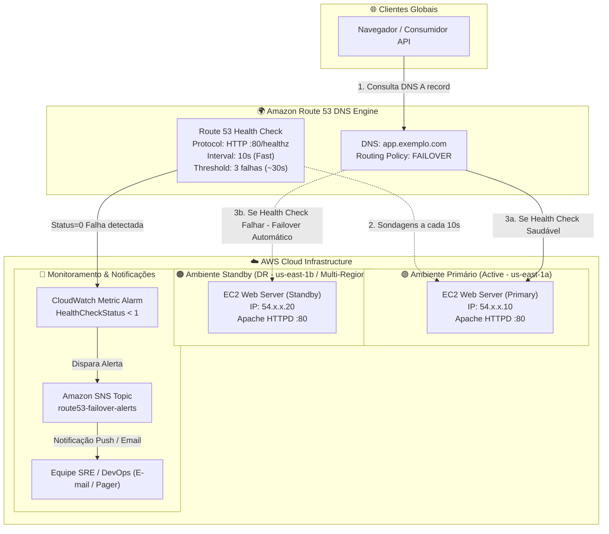

# AWS Lab: Resiliência Ativo/Standby com Route 53 Failover e Health Checks

[](https://aws.amazon.com/)
[](https://aws.amazon.com/route53/)
[](https://aws.amazon.com/solutions/disaster-recovery/)
[](LICENSE)

Implementação de estratégia de Disaster Recovery (DR) do tipo **Active-Passive (Ativo-Standby)** utilizando o **Amazon Route 53 Failover Routing Policy**, **Health Checks HTTP rápidos de 10 segundos** e alarmes em tempo real via **Amazon CloudWatch** e **Amazon SNS**.

---

## 🏛️ Diagrama de Arquitetura



---

## 📁 Estrutura do Repositório

```text
aws-lab-route53-failover/
├── .gitignore                          # Ignora arquivos temporários e chaves
├── README.md                           # Documentação detalhada e guia de execução
├── route53-records-template.json       # JSON ChangeBatch com definições dos registros Primary/Secondary
├── sns-notification-policy.json        # Política de acesso SNS para CloudWatch e Route 53
└── scripts/
    ├── health_check_setup.sh           # Criação automatizada de Health Check (10s) e Alarmes
    ├── primary_web_setup.sh            # Bootstrap do servidor Web Primário (Apache + UI Verde)
    ├── secondary_web_setup.sh          # Bootstrap do servidor Web Secundário (Apache + UI Laranja)
    └── simulate_failure.sh             # Script para simular queda do primário e chaveamento DNS
```

---

## ⚙️ Decisões Técnicas de Arquitetura

1. **Roteamento de Failover Ativo-Passivo (Active-Passive):**
   - Garante que 100% do tráfego seja direcionado ao nó primário sob operação normal, mantendo o secundário como backup imediato com custo previsível e sem concorrência de escrita de dados.
2. **Health Check Rápido (10s Fast Interval):**
   - Reduz drasticamente o **Recovery Time Objective (RTO)** de minutos para aproximadamente **30 a 40 segundos** (3 verificações consecutivas em intervalo de 10s).
3. **TTL Curto (60 segundos):**
   - Registros DNS do tipo Failover devem utilizar TTL baixo (60 segundos ou menos) para evitar que caches recursivos de ISPs retenham o IP do servidor primário indisponível.
4. **Notificação Proativa via SNS:**
   - O alarme CloudWatch monitora a métrica `AWS/Route53 -> HealthCheckStatus`. Qualquer degradação notifica imediatamente a equipe operacional para investigação.

---

## 🚀 Guia Passo a Passo de Implantação

### Pré-requisitos
- Conta AWS com permissões para Route 53, EC2, CloudWatch e SNS.
- Domínio registrado no Route 53 ou Zona Hospedada Pública (Public Hosted Zone).

---

### Passo 1: Provisionar os Servidores EC2 (Primário e Secundário)

Lance duas instâncias EC2 com **Amazon Linux 2023** em Zonas de Disponibilidade distintas:

```bash
# Obter ID da AMI mais recente
AMI_ID=$(aws ssm get-parameter \
  --name "/aws/service/ami-amazon-linux-latest/al2023-ami-kernel-default-x86_64" \
  --query "Parameter.Value" --output text)

# Obter VPC Padrão e Subnets
VPC_ID=$(aws ec2 describe-vpcs --filters "Name=isDefault,Values=true" --query "Vpcs[0].VpcId" --output text)
SUBNET_A=$(aws ec2 describe-subnets --filters "Name=vpc-id,Values=$VPC_ID" "Name=availability-zone,Values=us-east-1a" --query "Subnets[0].SubnetId" --output text)
SUBNET_B=$(aws ec2 describe-subnets --filters "Name=vpc-id,Values=$VPC_ID" "Name=availability-zone,Values=us-east-1b" --query "Subnets[0].SubnetId" --output text)

# Criar Security Group com portas 80 (HTTP) e 22 liberadas
SG_ID=$(aws ec2 create-security-group \
  --group-name "sg-route53-failover-lab" \
  --description "Security group para lab Route 53 Failover" \
  --vpc-id "$VPC_ID" --query "GroupId" --output text)

aws ec2 authorize-security-group-ingress --group-id "$SG_ID" --protocol tcp --port 80 --cidr 0.0.0.0/0

# Iniciar Servidor Primário (AZ us-east-1a)
USER_DATA_PRI=$(base64 -w 0 scripts/primary_web_setup.sh 2>/dev/null || base64 scripts/primary_web_setup.sh)
INSTANCE_PRI=$(aws ec2 run-instances \
  --image-id "$AMI_ID" \
  --instance-type t3.micro \
  --subnet-id "$SUBNET_A" \
  --security-group-ids "$SG_ID" \
  --user-data "$USER_DATA_PRI" \
  --tag-specifications 'ResourceType=instance,Tags=[{Key=Name,Value=WebServer-Primary}]' \
  --query "Instances[0].InstanceId" --output text)

# Iniciar Servidor Secundário (AZ us-east-1b)
USER_DATA_SEC=$(base64 -w 0 scripts/secondary_web_setup.sh 2>/dev/null || base64 scripts/secondary_web_setup.sh)
INSTANCE_SEC=$(aws ec2 run-instances \
  --image-id "$AMI_ID" \
  --instance-type t3.micro \
  --subnet-id "$SUBNET_B" \
  --security-group-ids "$SG_ID" \
  --user-data "$USER_DATA_SEC" \
  --tag-specifications 'ResourceType=instance,Tags=[{Key=Name,Value=WebServer-Secondary}]' \
  --query "Instances[0].InstanceId" --output text)

# Obter IPs Públicos
sleep 20
PRIMARY_IP=$(aws ec2 describe-instances --instance-ids "$INSTANCE_PRI" --query "Reservations[0].Instances[0].PublicIpAddress" --output text)
SECONDARY_IP=$(aws ec2 describe-instances --instance-ids "$INSTANCE_SEC" --query "Reservations[0].Instances[0].PublicIpAddress" --output text)

echo "Servidor Primario:   http://$PRIMARY_IP"
echo "Servidor Secundario: http://$SECONDARY_IP"
```

---

### Passo 2: Configurar Tópico Amazon SNS para Alertas

```bash
# 1. Criar Tópico SNS
SNS_ARN=$(aws sns create-topic --name "route53-failover-alerts" --query "TopicArn" --output text)

# 2. Inscrever e-mail operacional
aws sns subscribe \
  --topic-arn "$SNS_ARN" \
  --protocol email \
  --notification-endpoint "seu-email@dominio.com"

# 3. Aplicar política de autorização
aws sns set-topic-attributes \
  --topic-arn "$SNS_ARN" \
  --attribute-name Policy \
  --attribute-value file://sns-notification-policy.json
```

---

### Passo 3: Criar Route 53 Health Check (Intervalo de 10s)

Execute o script de automação fornecido no repositório:

```bash
chmod +x scripts/health_check_setup.sh
./scripts/health_check_setup.sh "$PRIMARY_IP" "$SNS_ARN"
```

Guarde o **HealthCheckId** retornado pelo script.

---

### Passo 4: Criar Registros DNS de Failover no Route 53

Substitua os placeholders no arquivo `route53-records-template.json` ou execute via CLI:

```bash
HOSTED_ZONE_ID="Z1234567890ABC" # Substitua pelo ID da sua Hosted Zone
DOMAIN_NAME="app.seudominio.com"

# Montar e aplicar o ChangeBatch
cat <<EOF > change-batch.json
{
  "Comment": "Registros de Failover Route 53",
  "Changes": [
    {
      "Action": "UPSERT",
      "ResourceRecordSet": {
        "Name": "$DOMAIN_NAME",
        "Type": "A",
        "SetIdentifier": "Primary-Active",
        "Failover": "PRIMARY",
        "TTL": 60,
        "ResourceRecords": [{"Value": "$PRIMARY_IP"}],
        "HealthCheckId": "$HEALTH_CHECK_ID"
      }
    },
    {
      "Action": "UPSERT",
      "ResourceRecordSet": {
        "Name": "$DOMAIN_NAME",
        "Type": "A",
        "SetIdentifier": "Secondary-Standby",
        "Failover": "SECONDARY",
        "TTL": 60,
        "ResourceRecords": [{"Value": "$SECONDARY_IP"}]
      }
    }
  ]
}
EOF

aws route53 change-resource-record-sets \
  --hosted-zone-id "$HOSTED_ZONE_ID" \
  --change-batch file://change-batch.json
```

---

## 🧪 Teste de Simulação de Queda (Disaster Simulation)

### 1. Testar Roteamento Normal
Abra seu navegador ou terminal e consulte seu domínio:
```bash
curl -s "http://$DOMAIN_NAME" | grep "PRIMARY ACTIVE"
```
O servidor primário responderá com a interface verde de produção.

---

### 2. Simular Desastre (Parar o Apache no Servidor Primário)
Conecte-se via SSH ou execute no servidor primário:

```bash
chmod +x scripts/simulate_failure.sh
./scripts/simulate_failure.sh down
```

---

### 3. Observar o Chaveamento Automático
Monitore as consultas DNS e respostas HTTP a cada 5 segundos:

```bash
./scripts/simulate_failure.sh test-dns "$DOMAIN_NAME"
```

**Cronologia da transição:**
- **0s:** O serviço web é interrompido.
- **~30s:** O Route 53 acumula 3 falhas de sondagem consecutivas e marca o endpoint primário como **Unhealthy**.
- **~35s:** O alarme CloudWatch dispara e publica mensagem no tópico SNS (você recebe o e-mail de alerta).
- **~60s:** O cache TTL local expira e todas as novas consultas DNS resolvem para o IP do **Servidor Secundário** (`SECONDARY_IP`), exibindo a página laranja de Disaster Recovery.

---

### 4. Testar Failback (Recuperação do Primário)
No servidor primário, restaure o Apache:

```bash
./scripts/simulate_failure.sh up
```

Após 3 sondagens bem-sucedidas (30s), o Route 53 detecta a restauração do endpoint primário e automaticamente volta a responder com o IP primário.

---

## 💰 Estimativa de Custos

| Recurso AWS | Tipo / Quantidade | Custo Estimado (us-east-1) |
| :--- | :--- | :--- |
| **Zona Hospedada Route 53** | 1 Hosted Zone pública | ~$0.50/mês |
| **Route 53 Health Check** | 1 Endpoint HTTP com Fast Interval (10s) | ~$0.75/mês |
| **EC2 Instâncias (2x)** | `t3.micro` | Coberto pelo **AWS Free Tier** (750h/mês) |
| **Amazon CloudWatch Alarm** | 1 Métrica de Alarme | ~$0.10/mês (10 primeiros gratuitos) |
| **Amazon SNS** | Notificações de email | Gratuito (1.000 emails/mês no Free Tier) |

> 💡 **Custo de Laboratório:** Executar este laboratório por 2 horas consome menos de **US$ 0.05**.

---

## 🧹 Teardown / Limpeza de Recursos

Para evitar custos após o término do laboratório:

```bash
# 1. Remover Registros DNS no Route 53
# Edite change-batch.json mudando "Action": "UPSERT" para "Action": "DELETE"
aws route53 change-resource-record-sets --hosted-zone-id "$HOSTED_ZONE_ID" --change-batch file://change-batch.json

# 2. Deletar CloudWatch Alarm
aws cloudwatch delete-alarms --alarm-names "Route53-Primary-Unhealthy-Alarm"

# 3. Deletar Route 53 Health Check
aws route53 delete-health-check --health-check-id "$HEALTH_CHECK_ID"

# 4. Deletar Tópico SNS
aws sns delete-topic --topic-arn "$SNS_ARN"

# 5. Terminar Instâncias EC2
aws ec2 terminate-instances --instance-ids "$INSTANCE_PRI" "$INSTANCE_SEC"

# 6. Deletar Security Group
sleep 45
aws ec2 delete-security-group --group-id "$SG_ID"

echo "[✓] Todos os recursos do laboratório foram removidos com sucesso!"
```
